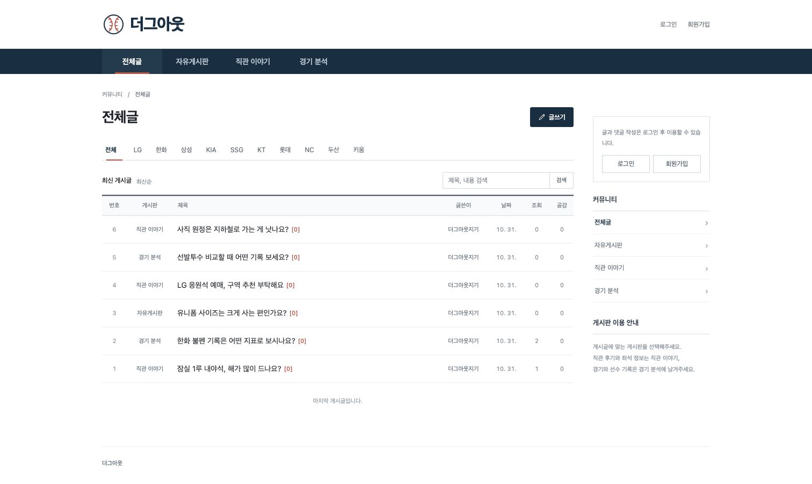

# 더그아웃

더그아웃은 자유게시판, 직관 이야기, 경기 분석 게시판으로 구성된 야구 커뮤니티입니다.

흰색 화면에 남색 메뉴를 두고, 게시글은 번호와 제목, 작성자, 날짜를 한 행에 표시합니다. 회원가입 없이 글을 읽고 검색할 수 있고, 글이나 댓글을 남길 때 로그인합니다.



[모바일 화면 보기](docs/images/mobile.jpg)

## 실행 환경

Java 21, Node.js 24 이상, MySQL 8.4, Elasticsearch 8.18.5와 Nori 플러그인이 필요합니다. 로컬 DB와 검색 엔진을 준비하는 방법은 [개발 환경 설정](docs/local-development.md)에 적었습니다.

백엔드와 프런트엔드를 실행한 뒤 **http://localhost:3000** 에서 확인할 수 있습니다.

## 들어 있는 기능

- 자유게시판, 직관 이야기, 경기 분석 분류별 글 작성, 조회, 검색
- 게시글과 댓글 등록, 수정, 삭제
- 게시글 공감
- Elasticsearch Nori 기반 한국어 검색과 구단 약칭 검색 (`LG`, `엘지`, `트윈스` 등)
- 관련도순, 최신순 검색, 구단 이름 바로 검색, 검색어가 유지되는 주소
- 모바일 화면, 키보드 탐색, 로딩 상태와 빈 결과, 오류 안내, 글쓰기 임시 보관
- 게시글, 댓글 작성자 일괄 조회와 동시 요청 시 카운트 갱신

구단 버튼은 해당 구단 이름으로 게시글을 검색합니다. 실시간 경기 일정, 순위 API는 연결하지 않았습니다.

## 개발 환경

백엔드는 Java 21 / Spring Boot 3.5.5, 프런트엔드는 HTML, CSS, JavaScript / Express입니다. DB는 MySQL 8.4, 검색 엔진은 Elasticsearch 8.18.5 + Nori를 사용합니다.

DB와 검색 엔진을 준비한 뒤 터미널 두 개에서 실행합니다.

```bash
# 첫 번째 터미널 (JAVA_HOME은 Java 21)
cd community-BE
./gradlew bootRun --args='--spring.profiles.active=local,search --spring.elasticsearch.uris=http://localhost:19200 --server.port=18080'

# 두 번째 터미널
cd community-FE
npm ci
API_UPSTREAM=http://localhost:18080 npm start
```

로컬 설정은 `application-local.properties`에 있습니다. 로컬 프로필은 테이블을 생성, 갱신하고 테스트용 자격 증명을 사용하므로 운영에 사용하지 마세요. 이미지 주소를 입력해 사진을 첨부할 수 있으며, 기존 S3 업로드 API를 사용하려면 별도의 AWS 설정이 필요합니다.

## 테스트

```bash
# 외부 서비스 없이: JPA 조회 쿼리 수, 권한 및 CRUD 회귀 테스트
cd community-BE
./gradlew test

# 프런트엔드 서버와 API 프록시
cd ../community-FE
npm ci
npm test

# 로컬 백엔드, MySQL, Elasticsearch가 실행 중일 때
cd ..
node scripts/integration-test.mjs
node scripts/auth-test.mjs
cd community-FE
npx playwright install chromium
npm run test:e2e
```

브라우저 테스트는 데스크톱과 모바일에서 회원가입 → 글 작성 → 검색 → 댓글 → 수정 → 삭제를 확인합니다. 자세한 검증 범위와 결과는 [테스트 기록](docs/testing.md)에 적었습니다.

## 검색을 운영 환경에 붙일 때

검색은 `search` 프로필 또는 `APP_SEARCH_ENABLED=true`로 켭니다. 게시글과 검색 색인은 outbox를 통해 비동기로 동기화되므로 검색 반영까지 잠깐의 지연이 있습니다.

기존 DB에는 outbox 테이블과 게시판 분류 추가, 본문과 댓글의 길이 확장을 먼저 적용하고, 기존 글은 한 번 backfill해야 합니다. 설정, 장애 복구, 재색인 순서는 [검색 운영 문서](docs/search.md)를 확인하세요. 운영 Elasticsearch에는 인증과 TLS를 설정해야 합니다. 개발 환경 문서의 인증 없는 단일 노드는 로컬에서만 사용하세요.

## develop에서 main으로

기능 작업은 `feat/*` 브랜치에서 진행하고, `feat: ...` 형식으로 커밋합니다. 검토한 변경을 `develop`에 모으고 `main`을 대상으로 PR을 만듭니다. `feat/*`, `develop` 푸시와 PR에서는 자동 검증을 실행합니다.

```bash
git push -u origin develop
gh pr create --base main --head develop --title "야구 커뮤니티 개편 및 Elasticsearch 검색 도입" --body-file docs/pull-request.md
```

`main`에 병합하면 백엔드와 프런트엔드 이미지를 커밋 SHA 태그로 발행합니다. GitOps chart의 `image.tag`를 발행된 SHA로 변경해야 클러스터에 반영됩니다. 런타임 설정은 Kubernetes Secret과 ConfigMap에서 공급하며 이미지에 넣지 않습니다. 병합 전에는 운영 DB 마이그레이션과 검색 환경변수, GitHub Actions의 기존 배포 시크릿을 확인하세요.

화면 구성의 근거와 참고한 자료는 [디자인 메모](docs/design.md)에 모았습니다.
